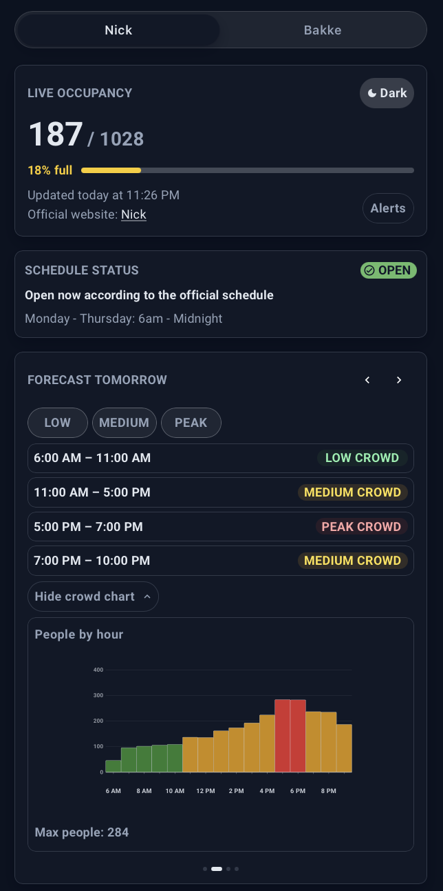
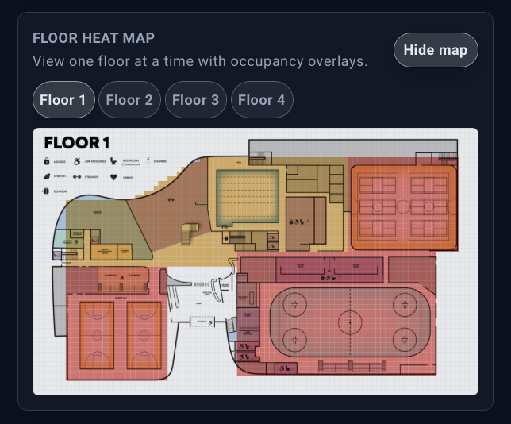
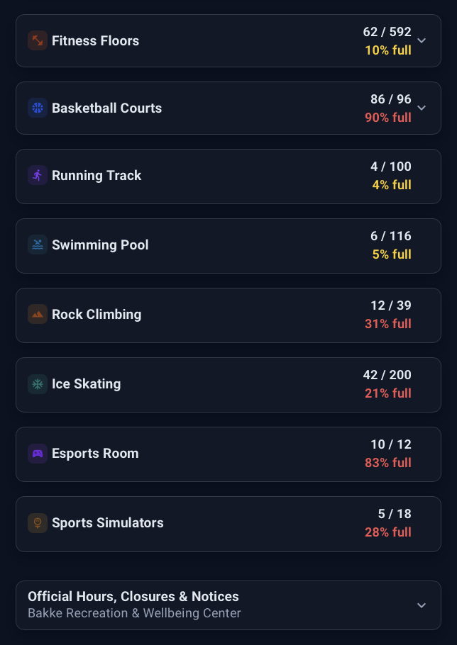
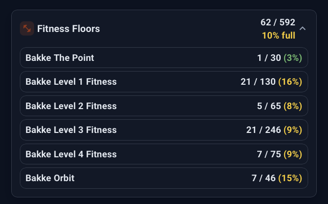

# RecLive

RecLive helps UW–Madison students choose when and where to exercise using gym occupancy, forecasts, and alerts.

## Overview

Check how busy the Nicholas Recreation Center (Nick) and Bakke Recreation & Wellbeing Center are, see which areas have room, and plan a visit around quieter hours.

## Demo

[Open RecLive](https://reclive.netlify.app) · [Nick](https://reclive.netlify.app/nick) · [Bakke](https://reclive.netlify.app/bakke)

### Screenshots

Captured on the live RecLive website. Select any preview to open the full-size screenshot.

#### Nick occupancy and forecast

<a href="docs/media/nick-dashboard.webp"></a>

#### Bakke floor heat map

<a href="docs/media/bakke-floor-map.webp"></a>

#### Bakke area occupancy

<a href="docs/media/bakke-area-occupancy.webp"></a>

#### Bakke fitness floor details

<a href="docs/media/bakke-fitness-floors.webp"></a>

## Features

- Live building and area occupancy with interactive floor maps.
- Seven-day crowd forecasts, quieter visit windows, and official opening hours.
- One-time Web Push alerts when an area reaches or falls below a chosen threshold, with expiry and cancellation.
- An installable web app with a cached app shell and automatic refresh when the tab returns or reconnects.

## How it works

The dashboard tries the public RecWell widget feed, then falls back to recent API snapshots or the browser cache. It checks freshness and coverage before showing a count. Separately, a Python collector validates and stores occupancy snapshots and history in SQL, and a schedule collector refreshes official opening hours.

The forecast job combines historical occupancy, calendar patterns, opening hours, and weather. It publishes a JSON artifact that FastAPI serves to the dashboard. The API also stores alert rules and checks them against current occupancy before sending Web Push.

## Tech stack

| Layer | Technologies and role |
| --- | --- |
| Dashboard | React, TypeScript, and Material UI for the interface. Axios and Zod handle API calls and validation. |
| Web app | Vite and Workbox build the PWA and its service worker. |
| Backend | FastAPI serves occupancy, forecasts, schedules, health, and alerts. MySQL or MariaDB stores snapshots, history, and alert state. |
| Scheduled jobs | Requests and Beautiful Soup collect inputs. NumPy and XGBoost prepare features and forecast occupancy using Open-Meteo weather. pywebpush sends notifications. |

## Getting started

Use Node.js 22, Python 3.12, and a dedicated local MySQL 8.0/8.4 or MariaDB 10.11 database. On macOS, XGBoost requires the OpenMP runtime (`brew install libomp`). Clone the repository and install its dependencies.

```bash
git clone https://github.com/ant0n-grachev/RecLive.git
cd RecLive
npm ci
python3.12 -m venv .venv
source .venv/bin/activate
python -m pip install -r server/requirements.txt -r server/requirements-dev.txt
cp -n .env.example .env
```

Set the local values shown below and replace the `GYM_DB_*` placeholders with credentials for a new, empty local database. Run the migrations with that local configuration, then start the API.

```bash
PUSH_RULE_SCHEMA_CUTOVER_READY=1 dotenv run --override -- python server/migrate.py
uvicorn server.forecast_api:app --host 127.0.0.1 --port 8000 --reload
```

The cutover flag applies only to the migration command. The [database guide](docs/operations/database.md) covers safeguards for existing databases.

In a second terminal from the repository root, run `npm run dev -- --host 127.0.0.1 --port 5173`. Open [the local dashboard](http://127.0.0.1:5173/nick) or [the API docs](http://127.0.0.1:8000/docs).

To populate local state, configure the upstream sources before running `python server/facility_hours_fetch.py`, `python server/gym_fetch.py`, and `python server/forecast_job.py`. These commands fetch external data and write local state. Meaningful forecasts require historical observations. See the [operator runbook](docs/operations/runbook.md) for deployment and scheduling.

## Configuration

```dotenv
VITE_API_BASE_URL=http://127.0.0.1:8000
VITE_SITE_URL=http://127.0.0.1:5173
FORECAST_API_ALLOW_ORIGINS=http://127.0.0.1:5173
APP_ENV=development
PUSH_EVALUATOR_ENABLED=false
GYM_DB_HOST=127.0.0.1
GYM_DB_PORT=3306
GYM_DB_NAME=reclive_dev
GYM_DB_USER=reclive_local
GYM_DB_PASSWORD=replace_with_local_password
```

Only `VITE_API_BASE_URL` and `VITE_SITE_URL` enter the browser build. The API base is an origin or deployment prefix without an `/api` suffix. Keep database credentials, `LIVE_COUNTS_URL`, and VAPID and push settings on the backend. See [the example environment](.env.example) for available settings and defaults.

## Testing

```bash
npm run check:version
npm run lint
env -u NODE_OPTIONS node tests/frontend/run-isolated.cjs build
env -u NODE_OPTIONS node tests/frontend/run-isolated.cjs test:run
npx playwright install chromium
env -u NODE_OPTIONS node tests/frontend/run-isolated.cjs test:e2e
source .venv/bin/activate
ruff check server tests
python -m pytest -q -m 'not mysql'
```

The frontend launcher uses synthetic public URLs. Browser tests cover the built app with fixture data, including keyboard and accessibility checks. For database integration, point `TEST_MYSQL_*` at a disposable database and run `python -m pytest -q`. The fixtures drop and recreate the test database. CI covers MySQL 8.4 and MariaDB 10.11. See the [verification procedure](docs/operations/runbook.md#evidence-record) for coverage, isolation, and dependency checks. Device installation and live notification delivery require separate manual verification.

## Limitations

- Occupancy depends on the RecWell feed and expires when it becomes stale. The offline shell can show recently cached data until it expires.
- Forecasts are estimates. Internal model diagnostics and hourly comparisons of previously published forecasts measure different things. The [published forecast summary](docs/forecasting.md#hourly-verification) reports error by lead time and has yet to compare the served forecasts with a simple baseline.
- Web Push requires browser support, permission, and HTTPS for deployment. A provider accepting a message does not establish device delivery.

## Project structure

| Path | Contents |
| --- | --- |
| [`src/`](src/) and [`public/`](public/) | Dashboard, service worker, floor maps, and static assets. |
| [`server/reclive/`](server/reclive/) and [`server/migrations/`](server/migrations/) | API, ingestion, forecasting, push, and versioned SQL migrations. |
| [`tests/`](tests/) | Backend, browser, isolation, and fixture tests. |
| [`docs/`](docs/) | [Architecture](docs/architecture.md), [forecasting](docs/forecasting.md), and [operations](docs/operations/runbook.md). |

## Versioning and credits

See the [changelog](CHANGELOG.md) for upcoming changes. RecLive uses Semantic Versioning. The application version is in [`package.json`](package.json) and is mirrored in [`package-lock.json`](package-lock.json). Release labels use `vX.Y.Z`. The prepared application version is `v0.0.2` (unreleased).

Built by Anton and [Alex](https://github.com/alexgabrichidze) under the [Apache 2.0 license](LICENSE). Open an issue for general feedback and follow [the security policy](SECURITY.md) for sensitive reports.
