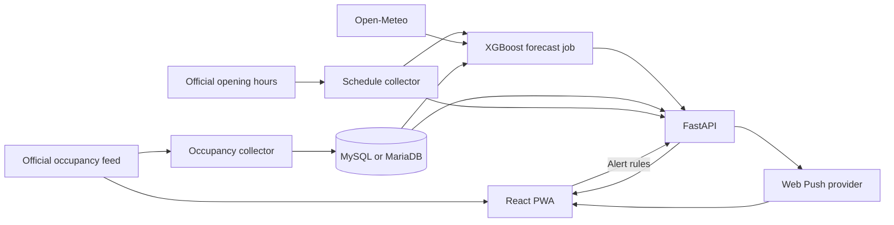

# Architecture

## Architecture and configuration boundaries

The browser is a React/Vite PWA. The FastAPI service reads current snapshots
and push state from SQL, plus forecasts and schedules from backend artifacts.
MySQL or MariaDB retains schema migrations, current occupancy snapshots,
history, ingestion runs, alert rules, and rate-limit counters.

Live occupancy tries the public feed used by UW RecWell's
[Live Building Usage widget](https://recwell.wisc.edu/locations/) first, then
RecLive's `/api/live-counts` snapshots. The public widget integration is separate
from the private backend ingestion configuration. `LIVE_COUNTS_URL` is never
sent to the browser. Forecasts, schedules, and push alerts still use RecLive's API.

A source is usable for the selected facility when fresh observations cover at
least 80% of its open capacity, or every configured area is confirmed closed.
Malformed, empty, incomplete, or failed responses trigger the backup. Backup
and saved-browser readings retain their observation timestamps and are usable
for at most ten minutes. Receiving them again does not make them fresh. The
official adapter timestamps successful observations when received and bypasses
browser response caching. Both paths ultimately depend on the same official
measurements, so the backup bridges short outages rather than generating new
counts.

Missing optional information is hidden. If no usable occupancy remains, the
dashboard shows only a simple unavailable screen with a retry action and the
facility selector. Normal facility closures remain distinct from outages. Live
polling and visibility/reconnection refresh restore the dashboard automatically.

Only the public frontend variables `VITE_API_BASE_URL` and `VITE_SITE_URL` may
enter the browser build. `VITE_API_BASE_URL` is an origin or deployment prefix,
without an `/api` suffix. The client appends canonical `/api/...` paths. For a
local frontend-origin build, use
`VITE_API_BASE_URL=http://127.0.0.1:4173` and
`VITE_SITE_URL=http://127.0.0.1:4173`, with a same-origin proxy routing
`/api/...` to FastAPI. A separately exposed backend origin can instead be the
prefix when that is the real deployment topology.

`LIVE_COUNTS_URL`, database settings, `PUSH_VAPID_PUBLIC_KEY`, the VAPID private
key, the endpoint-hash key, and the admin token are backend-only environment
inputs and must never gain a `VITE_` prefix. The public VAPID value is delivered
at runtime by GET `/api/push/public-key` as `{ "publicKey": ... }`. It is not a
third build-time variable. Push subscriptions are browser-generated runtime
material sent to the backend. They must not be bundled, logged, or exposed by
public/readiness responses, while the VAPID private key always remains on the
backend.

## Implementation map

- React Router handles the facility routes. Material UI, Emotion, Roboto,
  and Framer Motion supply the responsive interface. SVG overlays provide
  interactive floor maps.
- Axios and Zod handle requests and response validation. The custom Workbox
  service worker provides app-shell caching and update prompts.
- FastAPI runs under Uvicorn and uses PyMySQL for database access. Requests and
  Beautiful Soup handle occupancy ingestion and schedule extraction.
- Forecasting uses NumPy and XGBoost with Open-Meteo inputs. The Python backend
  uses pywebpush and VAPID to send browser notifications.

The dependency pins are in [`package-lock.json`](../package-lock.json),
[`server/requirements.txt`](../server/requirements.txt), and
[`server/requirements-dev.txt`](../server/requirements-dev.txt).
